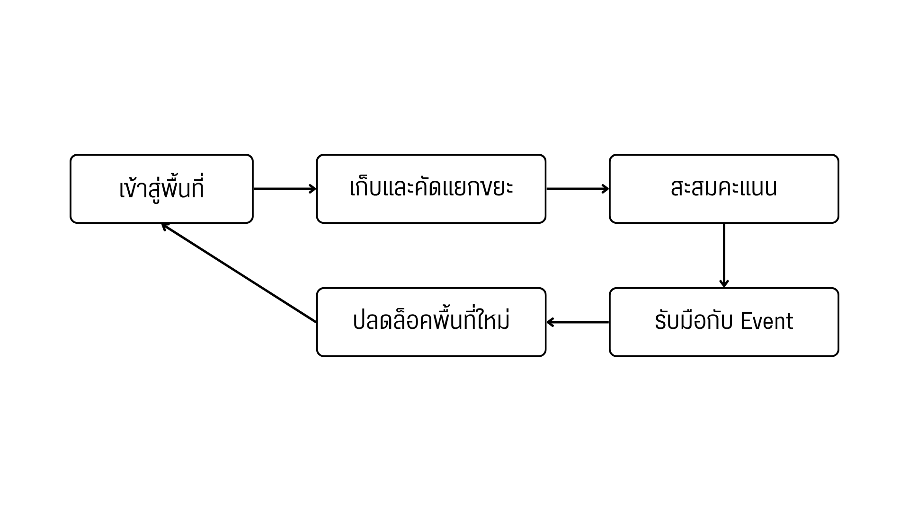

# Where is my bin? Game Design Document (GDD)
> *Casual / Arcade*

# บทนำ (Introduction)

**Where is my bin?**
เป็นเกมคัดแยกขยะในรูปแบบ 3 มิติ ซึ่งพัฒนาต่อยอดจาก Core Mechanics ของเกมต้นแบบ โดยนำระบบการคัดแยกขยะเดิมมาปรับปรุงและออกแบบใหม่ เพื่อเพิ่มความหลากหลายและสร้างประสบการณ์การเล่นที่สนุกสนานมากยิ่งขึ้น
> เกมนำเสนอการคัดแยกขยะ โดยผู้เล่นต้องเก็บขยะและนำไปทิ้งลงถังให้ถูกประเภทเพื่อสะสมคะแนน ขณะเดียวกันต้องรับมือกับ Event ที่อาจเปลี่ยนตำแหน่งถังขยะ เปลี่ยนประเภทถังหรือสร้างอุปสรรคระหว่างการเล่น
> เกมยังมีระบบแผนที่ ที่เปิดโอกาสให้ผู้เล่นปลดล็อกและเดินทางไปยังสถานที่ต่างๆ ในประเทศไทย เช่น สวนสาธารณะ ตลาดนัด โรงเรียน และชายหาด โดยแต่ละพื้นที่มีสภาพแวดล้อม รูปแบบขยะและเหตุการณ์เฉพาะตัวของงแต่ละสถานที่นั้น

# องค์ประกอบหลัก (Core Overview)

**ระบบการคัดแยกขยะ**
- ระบบการเล่นหลักของเกม ผู้เล่นต้องเก็บขยะและนำไปทิ้งลงถังที่ตรงกับประเภทของขยะ เพื่อสะสมคะแนนและผ่านเงื่อนไขของด่าน

**ระบบเหตุการณ์ระหว่างเล่น**
- ระบบที่สร้างเหตุการณ์พิเศษระหว่างการเล่น โดยทำงานตามเงื่อนไขที่กำหนด เช่น เมื่อคะแนนถึงเกณฑ์ หรือเมื่อผ่านช่วงเวลาที่กำหนด

**ระบบแผนที่และการปลดล็อกพื้นที่**
- ระบบแผนที่ใช้แสดงพื้นที่ทั้งหมดภายในเกม พร้อมสถานะการปลดล็อกและความก้าวหน้าของผู้เล่น

**ระบบสภาพแวดล้อมและพื้นที่**
- แต่ละพื้นที่ออกแบบให้มีองค์ประกอบแตกต่างกัน ทั้งขนาดพื้นที่ ตำแหน่งถังขยะ จุดเกิดขยะ เส้นทางการเคลื่อนที่ และสิ่งกีดขวาง

# กลุ่มเป้าหมาย

กลุ่มเป้าหมายเบื้องต้นคือวัยรุ่นและผู้เล่นทั่วไปที่ชื่นชอบเกมที่มีรูปแบบการเล่นเข้าใจง่าย มีเป้าหมายชัดเจนและสามารถสร้างความสนุกได้ในระยะเวลาไม่นาน

# Core Gameplay Loop
> 

**ขั้นตอนการเล่นเบื้องต้น**
- 1 เลือกพื้นที่
> ผู้เล่นเข้าสู่แผนที่และเลือกพื้นที่ที่ปลดล็อกแล้ว

- 2 เริ่มด่าน
> ผู้เล่นเข้าสู่พื้นที่ ซึ่งมีขยะ ถังขยะ และองค์ประกอบสภาพแวดล้อมตามที่กำหนด พร้อมรับเป้าหมายของด่าน เช่น คะแนนที่ต้องทำให้ได้หรือจำนวนขยะที่ต้องคัดแยก

- 3 เก็บและคัดแยกขยะ
> ผู้เล่นหยิบขยะและนำไปทิ้งลงถังที่ถูกประเภท เพื่อรับคะแนนและเพิ่มความก้าวหน้าของด่าน

- 4 เกิด Event
> เมื่อคะแนนหรือเงื่อนไขการเล่นถึงเกณฑ์ระบบจะสุ่ม Event ที่ส่งผลต่อสถานการณ์ เช่น ถังขยะเปลี่ยนตำแหน่ง ถังขยะเปลี่ยนประเภท

- 5 ปรับตัวและเล่นต่อ
> ผู้เล่นต้องสังเกตการเปลี่ยนแปลงและปรับวิธีเล่นให้เหมาะสม เพื่อรักษาคะแนนและทำเป้าหมายของด่านให้สำเร็จ

- 6 จบด่าน
> เมื่อครบเวลาหรือบรรลุเงื่อนไขจบด่าน ระบบจะแสดงผลคะแนน

- 7 ปลดล็อกความก้าวหน้า
> ถ้าคะแนนถึงที่กำหนด ผู่เล่นจะปลดล็อคพื้นที่ใหม่เพื่อพบกับความท้าทายครั้งใหม่
> ถ้าไม่ถึงเงื่อนไข ผู้เล่นต้องกลับไปเล่นด่านเดิมเพื่อพัฒนาผลงาน
