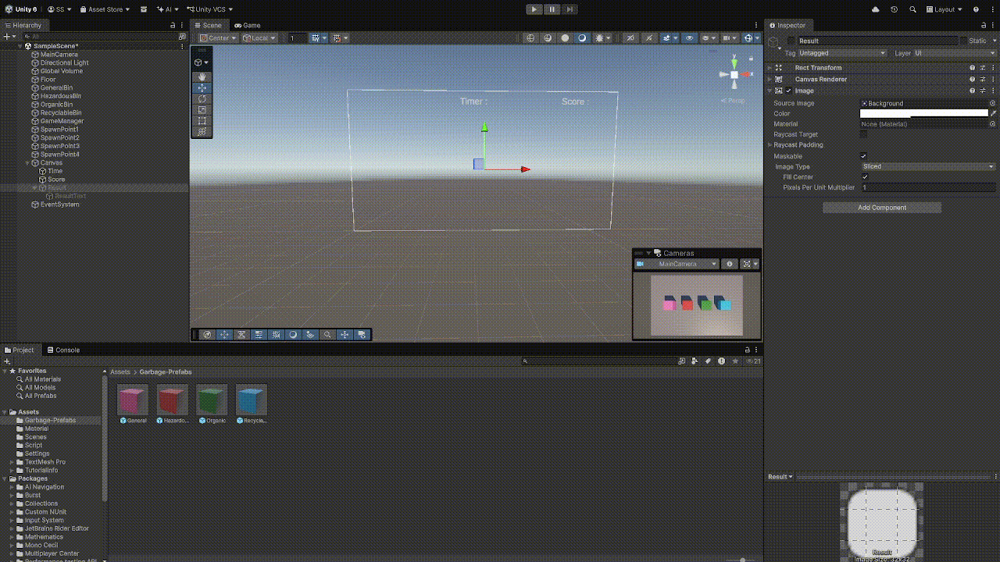

# Where is my bin?
เป็นเกมคัดแยกขยะในรูปแบบ 3 มิติ ซึ่งพัฒนาต่อยอดจาก Core Mechanics ของเกมต้นแบบ โดยนำระบบการคัดแยกขยะเดิมมาปรับปรุงและออกแบบใหม่ เพื่อเพิ่มความหลากหลายและสร้างประสบการณ์การเล่นที่สนุกสนานมากยิ่งขึ้น
> เกมนำเสนอการคัดแยกขยะ โดยผู้เล่นต้องเก็บขยะและนำไปทิ้งลงถังให้ถูกประเภทเพื่อสะสมคะแนน ขณะเดียวกันต้องรับมือกับ Event ที่อาจเปลี่ยนตำแหน่งถังขยะ เปลี่ยนประเภทถังหรือสร้างอุปสรรคระหว่างการเล่น

# Project Overview
- **My Role:** System Designer / Developer
- **Engine & Tools:** Unity Engine
- **Genre & Platform:** PC
- **Project Status:** Work In Progress

# Game Mechanics ระบบเดิม

# Key Features ในการต่อยอด
- **ระบบการคัดแยกขยะ**
> ระบบการเล่นหลักของเกม ผู้เล่นต้องเก็บขยะและนำไปทิ้งลงถังที่ตรงกับประเภทของขยะ เพื่อสะสมคะแนนและผ่านเงื่อนไขของด่าน

- **ระบบเหตุการณ์ระหว่างเล่น**
> ระบบที่สร้างเหตุการณ์พิเศษระหว่างการเล่น โดยทำงานตามเงื่อนไขที่กำหนด เช่น เมื่อคะแนนถึงเกณฑ์ หรือเมื่อผ่านช่วงเวลาที่กำหนด

- **ระบบสภาพแวดล้อมและพื้นที่**
> แต่ละพื้นที่ออกแบบให้มีองค์ประกอบแตกต่างกันทั้งขนาดพื้นที่ ตำแหน่งถังขยะ จุดเกิดขยะ เส้นทางการเคลื่อนที่ และสิ่งกีดขวาง

# Link
- [GDD](GDD_Garbage_Simulation.md)
